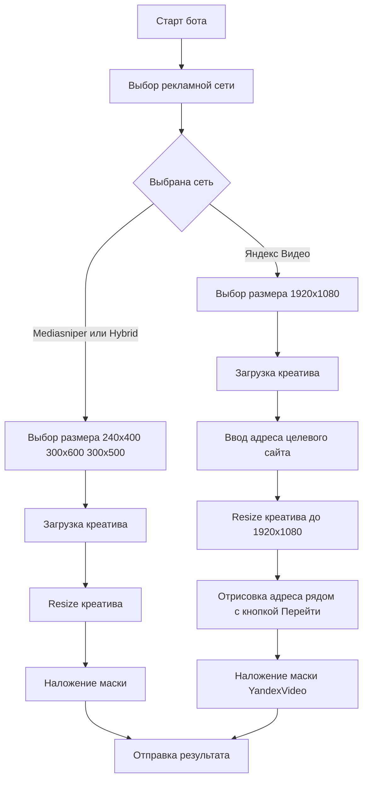
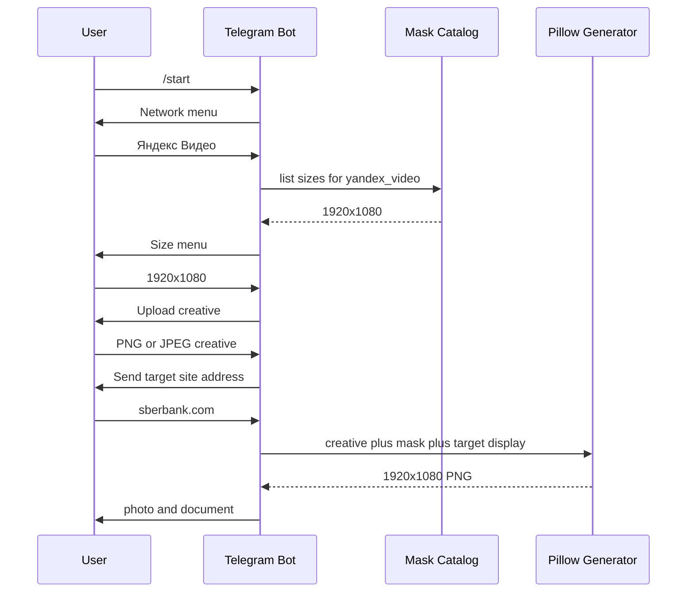

# План добавления flow `Яндекс Видео` в `reports_ad`

## 1. Цель изменения

Добавить в Telegram-бот `reports_ad` новый пользовательский flow `Яндекс Видео`, который работает рядом с текущими mask-only flow для `Mediasniper` и `Hybrid`:

1. пользователь выбирает рекламную сеть `Яндекс Видео`;
2. бот показывает доступный формат `1920×1080`;
3. пользователь загружает исходный креатив PNG/JPEG;
4. бот запрашивает адрес целевого сайта для подписи в баннере;
5. система приводит креатив к размеру `1920×1080`;
6. система берет маску `reports_ad/reports_ad/data/masks/YandexVideo/1920x1080.png`;
7. система вставляет адрес целевого сайта в область слева от кнопки `Перейти`, как в эталоне `docs/reports/examples/FD -- Примеры скриншотов/Яндекс/Яндекс_Видео_in-stream.jpeg`;
8. система накладывает маску поверх подготовленного креатива;
9. результат возвращается пользователю в Telegram как photo и PNG document.

## 2. Текущее состояние кода

### 2.1. Telegram flow

Текущий активный flow реализован в `reports_ad/reports_ad/bot.py`:

- состояния `NETWORK`, `BANNER_TYPE`, `CREATIVE` объявлены в `reports_ad/reports_ad/bot.py`;
- `start()` очищает состояние, создает `request_id`, показывает список сетей и summary каталога;
- `collect_network()` валидирует выбранную сеть через `validate_mask_network_slug()`;
- `collect_banner_type()` валидирует размер через `validate_banner_size_slug()`;
- `collect_creative()` принимает PNG/JPEG и сразу запускает `_generate()`;
- `_generate()` строит `MaskedBannerRequest`, вызывает `generate_masked_banner()` и отправляет результат через path-based retry helpers.

Для `Яндекс Видео` текущий flow нужно расширить условно: после загрузки креатива нельзя сразу запускать `_generate()`, потому что нужен дополнительный ввод адреса целевого сайта.

### 2.2. Каталог масок

Каталог находится в `reports_ad/reports_ad/mask_catalog.py`:

- `MASK_NETWORKS` сейчас содержит только `mediasniper` и `hybrid`;
- `SUPPORTED_BANNER_SIZES` содержит только `240x400`, `300x600`, `300x500`;
- `resolve_mask_asset()` строит путь `data/masks/<Network>/<Size>.png`.

Для `Яндекс Видео` нужно добавить сеть `yandex_video` с directory name `YandexVideo` и размер `1920x1080`, но не показывать `1920x1080` для `Mediasniper` и `Hybrid`, если таких масок нет и этот формат не нужен для них.

### 2.3. Генератор баннера

Генератор находится в `reports_ad/reports_ad/masked_banner.py`:

- `MaskedBannerRequest` сейчас содержит `request_id`, `network_slug`, `network_display_name`, `size_slug`, `size`, `creative`, `output_path`;
- `compose_masked_banner()` resize-ит креатив до выбранного размера, готовит маску через `_prepare_mask_overlay()` и делает `Image.alpha_composite()`;
- адрес целевого сайта и отрисовка текста сейчас не поддержаны.

Для `Яндекс Видео` нужно добавить отдельный шаг подготовки base creative до наложения маски: отрисовать display URL в координатах шаблона.

## 3. Целевой UX flow



### 3.1. Сценарий для `Mediasniper` и `Hybrid`

Оставить без изменения:

1. сеть → размер → креатив → генерация;
2. размеры только `240x400`, `300x600`, `300x500`;
3. без запроса landing URL.

### 3.2. Сценарий для `Яндекс Видео`

Добавить отдельную ветку:

1. сеть → `Яндекс Видео`;
2. размер → только `1920x1080`;
3. загрузка PNG/JPEG-креатива;
4. ввод адреса целевого сайта;
5. генерация `1920x1080` PNG.

Рекомендуемый текст prompt после загрузки креатива:

```text
Креатив принят. Отправьте адрес целевого сайта, который нужно показать слева от кнопки «Перейти», например: https://www.sberbank.com или sberbank.com
```

Рекомендуемое поведение ввода:

- принимать `https://example.com/path`, `http://example.com`, `example.com`;
- нормализовать значение для валидации как публичный HTTP/HTTPS URL;
- для визуального поля рендерить короткую форму без схемы и query, например `sberbank.com`;
- если введен путь и Product хочет показывать путь, ограничить длину и обрезать с многоточием;
- не открывать сайт и не проверять доступность страницы.

## 4. Изменения в данных и каталоге

### 4.1. Добавить тип capability для сетей

Расширить `MaskNetwork` в `reports_ad/reports_ad/mask_catalog.py` полями:

```python
@dataclass(frozen=True, slots=True)
class MaskNetwork:
    slug: str
    display_name: str
    directory_name: str
    flow_kind: str = 'masked_banner'
```

Предлагаемые значения:

- `masked_banner` для текущих `Mediasniper` и `Hybrid`;
- `yandex_video` для нового flow.

Это позволит условно выбирать размеры и дополнительные шаги без hardcode по display name.

### 4.2. Добавить сеть `Яндекс Видео`

В `MASK_NETWORKS` добавить:

```python
MaskNetwork(
    slug='yandex_video',
    display_name='Яндекс Видео',
    directory_name='YandexVideo',
    flow_kind='yandex_video',
)
```

Добавить aliases в `normalize_mask_network_slug()`:

- `yandex_video` → `yandex_video`;
- `yandex-video` → `yandex_video`;
- `яндекс_видео` → `yandex_video`;
- `яндекс видео` → `yandex_video`;
- `yandexvideo` → `yandex_video`.

### 4.3. Сделать размеры зависящими от сети

Сейчас `list_banner_sizes()` возвращает один общий список. Для новой логики нужно разделить поддерживаемые размеры по сети.

Вариант минимального изменения:

```python
NETWORK_BANNER_SIZES: dict[str, tuple[BannerSize, ...]] = {
    'mediasniper': STANDARD_BANNER_SIZES,
    'hybrid': STANDARD_BANNER_SIZES,
    'yandex_video': (BannerSize(slug='1920x1080', width=1920, height=1080),),
}
```

Добавить функции:

- `list_banner_sizes_for_network(network_slug: str) -> list[BannerSize]`;
- `get_banner_size_for_network(network_slug: str, size_slug: str) -> BannerSize | None`;
- `validate_banner_size_slug_for_network(raw_value: str, network_slug: str) -> str`.

Оставить старые `list_banner_sizes()`, `get_banner_size()`, `validate_banner_size_slug()` как compatibility wrappers, если тесты или legacy code их используют.

### 4.4. Проверить package data

В `reports_ad/pyproject.toml` уже есть package data pattern:

```toml
reports_ad = ['data/*.json', 'data/masks/*/*.png']
```

Он должен включить `data/masks/YandexVideo/1920x1080.png` без изменения. В план реализации включить проверку installed package lookup через `resolve_mask_asset('yandex_video', '1920x1080')`.

## 5. Изменения в Telegram runtime

### 5.1. Добавить состояние для адреса целевого сайта

В `reports_ad/reports_ad/bot.py` добавить новое состояние, например:

```python
NETWORK, BANNER_TYPE, CREATIVE, TARGET_SITE = range(4)
```

Legacy constants `SCREENSHOT`, `LANDING_URL`, `UTM`, `REVIEW` можно оставить, но нужно избежать пересечения чисел. Лучше явно перенумеровать:

```python
NETWORK, BANNER_TYPE, CREATIVE, TARGET_SITE = range(4)
SCREENSHOT, LANDING_URL, UTM, REVIEW = range(4, 8)
```

### 5.2. Изменить `collect_creative()`

Логика:

1. сохранить и валидировать креатив как сейчас;
2. определить выбранную сеть;
3. если `flow_kind == 'yandex_video'`, попросить адрес целевого сайта и вернуть `TARGET_SITE`;
4. иначе вызвать `_generate()` как сейчас.

Псевдокод:

```python
context.user_data['creative'] = creative_info
if selected_network_flow_kind(context.user_data) == 'yandex_video':
    await _reply_text_with_retry(... prompt target site ...)
    return TARGET_SITE
return await _generate(update, context)
```

### 5.3. Добавить handler `collect_target_site()`

Новый handler должен:

1. прочитать текст;
2. нормализовать URL или домен;
3. сохранить два значения:
   - `target_site_url` для полной нормализованной ссылки;
   - `target_site_display` для текста в баннере;
4. вызвать `_generate()`.

Пользовательская ошибка:

```text
Адрес целевого сайта не подходит: введите публичный домен или http/https URL, например sberbank.com или https://www.sberbank.com
```

### 5.4. Обновить `ConversationHandler`

В `states` добавить:

```python
TARGET_SITE: [_start_button_handler(), MessageHandler(filters.TEXT & ~filters.COMMAND, collect_target_site)]
```

### 5.5. Обновить тексты меню

`catalog_summary()` и `spec_menu_prompt()` должны показывать размер, доступный именно для выбранной сети:

- `Mediasniper` → `240x400`, `300x600`, `300x500`;
- `Hybrid` → `240x400`, `300x600`, `300x500`;
- `Яндекс Видео` → `1920x1080`.

Label сетевой кнопки для `Яндекс Видео` можно сделать `Яндекс Видео [yandex_video] — 1 размер`.

## 6. Изменения в генераторе изображений

### 6.1. Расширить request model

В `MaskedBannerRequest` добавить опциональные поля:

```python
target_site_url: str | None = None
target_site_display: str | None = None
```

Для текущих сетей они будут `None`. Для `yandex_video` поле `target_site_display` обязательно.

### 6.2. Добавить template config для `YandexVideo`

Создать в `reports_ad/reports_ad/masked_banner.py` или отдельном модуле `reports_ad/reports_ad/yandex_video.py` конфигурацию координат:

```python
YANDEX_VIDEO_TEMPLATE = YandexVideoTemplate(
    size_slug='1920x1080',
    display_url_bbox=BoundingBoxLike(x=60, y=880, width=390, height=58),
    font_size=34,
    text_color=(255, 255, 255, 255),
)
```

Точные координаты нужно уточнить при реализации по реальному `reports_ad/reports_ad/data/masks/YandexVideo/1920x1080.png` и эталону `docs/reports/examples/FD -- Примеры скриншотов/Яндекс/Яндекс_Видео_in-stream.jpeg`.

Предлагаемый способ уточнения координат:

1. открыть маску `YandexVideo/1920x1080.png`;
2. найти область CTA снизу: кнопка `Перейти` и поле слева;
3. определить bbox левого поля в координатах исходной маски;
4. зафиксировать координаты константами и покрыть pixel/smoke-тестом.

### 6.3. Отрисовать display URL до наложения маски

Добавить функцию:

```python
def render_yandex_video_target_site(base: Image.Image, display_text: str) -> Image.Image:
    ...
```

Правила:

- вход `base` уже `RGBA` и имеет размер `1920x1080`;
- текст рисуется в левой CTA-области до `Image.alpha_composite(base, mask)`;
- маска должна остаться верхним слоем, чтобы сохранить кнопку, затемнение, фон и визуальные рамки;
- текст должен быть читаемым и похожим на эталон;
- использовать кириллически совместимый системный шрифт, если доступен, или fallback через `ImageFont.load_default()`;
- если текст не помещается, уменьшить шрифт или обрезать с `…`.

### 6.4. Общая композиция

Изменить `compose_masked_banner()` так, чтобы она принимала опциональные параметры:

```python
def compose_masked_banner(
    *,
    creative_path: Path,
    mask_path: Path,
    output_path: Path,
    width: int,
    height: int,
    network_slug: str | None = None,
    target_site_display: str | None = None,
) -> tuple[int, int]:
```

Логика:

1. открыть креатив;
2. resize до `(width, height)`;
3. если `network_slug == 'yandex_video'`, вызвать `render_yandex_video_target_site()`;
4. открыть маску;
5. проверить размер маски;
6. подготовить overlay через `_prepare_mask_overlay()`;
7. выполнить `Image.alpha_composite(creative, mask)`;
8. сохранить PNG.

### 6.5. Валидация специальных требований `YandexVideo`

В `generate_masked_banner()` перед composition добавить:

- если `network_slug == 'yandex_video'` и `size_slug != '1920x1080'`, вернуть `ValidationError`;
- если `network_slug == 'yandex_video'` и нет `target_site_display`, вернуть `ValidationError`;
- если mask size не `1920×1080`, вернуть `ValidationError`.

## 7. Нормализация адреса целевого сайта

Добавить helper, например в `reports_ad/reports_ad/validation.py`:

```python
def normalize_target_site_for_display(raw_value: str) -> tuple[str, str]:
    ...
```

Контракт:

- вход: пользовательский текст;
- выход: `(normalized_url, display_text)`;
- если пользователь ввел `sberbank.com`, normalized URL становится `https://sberbank.com`;
- если пользователь ввел `https://www.sberbank.com/ru/person/avto?utm_source=...`, display text становится `sberbank.com` или `www.sberbank.com` по выбранному product rule;
- reject: пустая строка, `file:`, `data:`, localhost/private IP, слишком длинный мусор, строка без валидного host.

Рекомендуемый MVP display rule:

1. убрать scheme;
2. убрать query и fragment;
3. убрать leading `www.`;
4. оставить host;
5. если host длиннее лимита, обрезать с `…`.

## 8. Тест-план

### 8.1. Unit tests для каталога

Добавить проверки в `reports_ad/tests/test_validation.py` или `reports_ad/tests/test_composition.py`:

1. `list_mask_networks()` содержит `yandex_video`;
2. network label содержит `Яндекс Видео [yandex_video] — 1 размер`;
3. `spec_menu_keyboard('yandex_video')` содержит только `1920x1080`;
4. `spec_menu_keyboard('mediasniper')` не содержит `1920x1080`;
5. `resolve_mask_asset('yandex_video', '1920x1080')` возвращает существующий файл;
6. `resolve_mask_asset('mediasniper', '1920x1080')` возвращает safe validation error.

### 8.2. Unit tests для target site validation

Проверки:

1. `sberbank.com` → normalized URL `https://sberbank.com`, display `sberbank.com`;
2. `https://www.sberbank.com/ru/person/avto?utm_source=x` → display `sberbank.com` или выбранный вариант;
3. `file:///tmp/a.html` rejected;
4. `http://localhost:8000` rejected by default;
5. слишком длинный host корректно обрезается для render layer.

### 8.3. Unit tests для композиции `YandexVideo`

Проверки:

1. креатив любого валидного размера приводится к `1920×1080`;
2. маска `YandexVideo/1920x1080.png` накладывается без ошибки;
3. область слева от кнопки `Перейти` меняется после рендера display URL;
4. итоговый PNG читается Pillow и имеет размер `1920×1080`;
5. если `target_site_display` не передан для `yandex_video`, генератор возвращает `ValidationError`.

### 8.4. Telegram handler tests

Добавить тесты в `reports_ad/tests/test_validation.py`:

1. выбор `Яндекс Видео` переводит к меню размера `1920x1080`;
2. выбор `1920x1080` переводит к загрузке креатива;
3. после загрузки креатива бот просит адрес целевого сайта, а не запускает генерацию сразу;
4. после валидного адреса вызывается generator;
5. после невалидного адреса пользователь остается в состоянии `TARGET_SITE`;
6. для `Mediasniper` и `Hybrid` прежний автозапуск после креатива сохраняется.

### 8.5. Manual visual check

После реализации выполнить ручную проверку:

1. выбрать `Яндекс Видео`;
2. выбрать `1920x1080`;
3. загрузить тестовый креатив;
4. ввести `sberbank.com`;
5. сравнить результат с эталоном `docs/reports/examples/FD -- Примеры скриншотов/Яндекс/Яндекс_Видео_in-stream.jpeg`:
   - кнопка `Перейти` сохранена маской;
   - адрес сайта расположен слева от кнопки;
   - адрес визуально читаем;
   - итоговый файл не пустой и имеет `1920×1080`.

## 9. Пошаговый план реализации

1. Зафиксировать наличие `reports_ad/reports_ad/data/masks/YandexVideo/1920x1080.png` и его фактический размер через Pillow.
2. Расширить `MaskNetwork` в `reports_ad/reports_ad/mask_catalog.py` полем `flow_kind`.
3. Добавить сеть `yandex_video` с display name `Яндекс Видео` и directory name `YandexVideo`.
4. Добавить размер `1920x1080` и сетевую привязку размеров через `NETWORK_BANNER_SIZES`.
5. Заменить использование общего `list_banner_sizes()` в меню на `list_banner_sizes_for_network(network_slug)`.
6. Обновить `validate_banner_size_slug()` или добавить network-aware validator для запрета неподходящих размеров.
7. Добавить normalization aliases для `Яндекс Видео`.
8. Добавить helper определения `flow_kind` выбранной сети.
9. Добавить состояние `TARGET_SITE` в `reports_ad/reports_ad/bot.py`.
10. Обновить `ConversationHandler.states`, добавив обработчик `collect_target_site()`.
11. Изменить `collect_creative()`: для `yandex_video` сохранять креатив и запрашивать адрес целевого сайта, для остальных сетей оставлять немедленную генерацию.
12. Реализовать `collect_target_site()` с safe validation, сохранением `target_site_url` и `target_site_display`, затем запуском `_generate()`.
13. Расширить `MaskedBannerRequest` полями `target_site_url` и `target_site_display`.
14. Обновить `_build_masked_banner_request()` так, чтобы он передавал target site fields для `YandexVideo`.
15. Добавить функцию нормализации адреса целевого сайта в `reports_ad/reports_ad/validation.py`.
16. Добавить template constants для координат поля адреса в `YandexVideo`.
17. Реализовать функцию отрисовки display URL на resized creative до наложения маски.
18. Обновить `compose_masked_banner()` для conditional render step по `network_slug == 'yandex_video'`.
19. Добавить validation guard: `YandexVideo` требует `1920x1080` и `target_site_display`.
20. Обновить пользовательские тексты `start()`, `catalog_summary()`, `spec_menu_prompt()` и `creative_upload_prompt()` под новый flow.
21. Обновить `README.md`, указав, что `Яндекс Видео` дополнительно запрашивает адрес целевого сайта.
22. Добавить unit tests для каталога, target site validation, композиции и Telegram state transitions.
23. Запустить focused tests через `./.venv/bin/pytest -c pyproject.toml tests/test_validation.py tests/test_composition.py`.
24. Выполнить manual визуальную проверку результата `YandexVideo` на тестовом креативе.
25. Пересобрать Docker-сервис после реализации: `docker compose up -d --build --force-recreate reports-ad-bot`.

## 10. Риски и решения

| Риск | Почему важен | План снижения |
| --- | --- | --- |
| Координаты поля адреса в маске могут отличаться от эталона | Текст может попасть под кнопку или за пределы CTA-зоны | Сначала измерить маску, затем зафиксировать bbox константой и проверить вручную |
| Длинный адрес сайта не помещается | Telegram-пользователь может прислать длинный URL | Рендерить host без query, обрезать с многоточием, уменьшать font size в пределах bbox |
| Общий список размеров сломает старые сети | `1920x1080` может появиться у Mediasniper или Hybrid | Ввести network-aware size list и тест на отсутствие `1920x1080` у старых сетей |
| Нужен адрес сайта только для `YandexVideo` | Если запросить адрес у всех сетей, изменится существующий UX | Добавить условную ветку только по `flow_kind == 'yandex_video'` |
| Маска полностью непрозрачная | Текст под маской может быть перекрыт | Рисовать текст до наложения и проверить alpha/visual mask; если нужно, выделить text layer после маски только в CTA-bbox |
| Пользователь введет небезопасный URL | Не должно быть file или private-network значений | Использовать существующую URL validation policy и не открывать сайт |

## 11. Mermaid sequence target



## 12. Definition of Done

Изменение считается завершенным, если:

1. в меню сетей есть `Яндекс Видео`;
2. для `Яндекс Видео` доступен только размер `1920x1080`;
3. для `Mediasniper` и `Hybrid` прежние размеры не изменились;
4. после загрузки креатива в `Яндекс Видео` бот запрашивает адрес целевого сайта;
5. итоговая композиция использует `reports_ad/reports_ad/data/masks/YandexVideo/1920x1080.png`;
6. адрес целевого сайта виден слева от кнопки `Перейти`;
7. итоговый файл имеет размер `1920×1080` и отправляется как Telegram photo и PNG document;
8. focused unit tests проходят;
9. Docker runtime после rebuild использует обновленный код.
